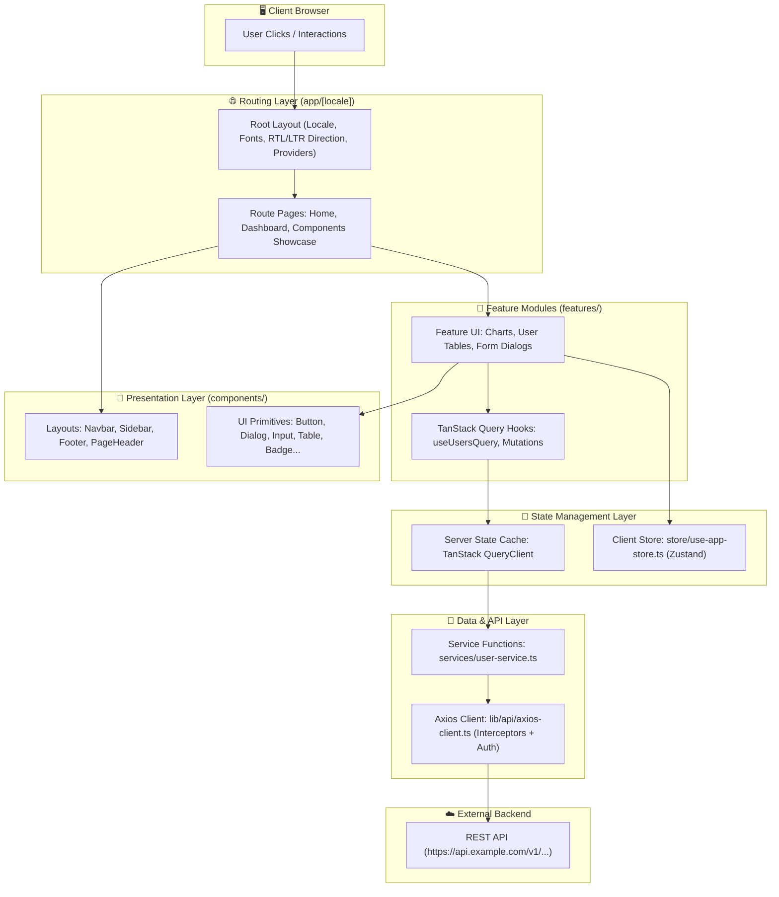
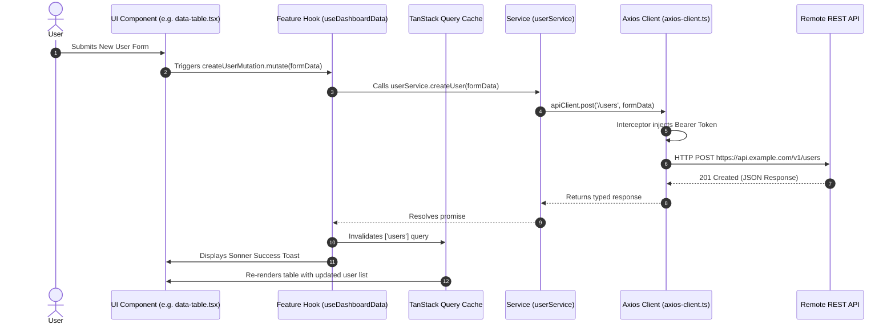
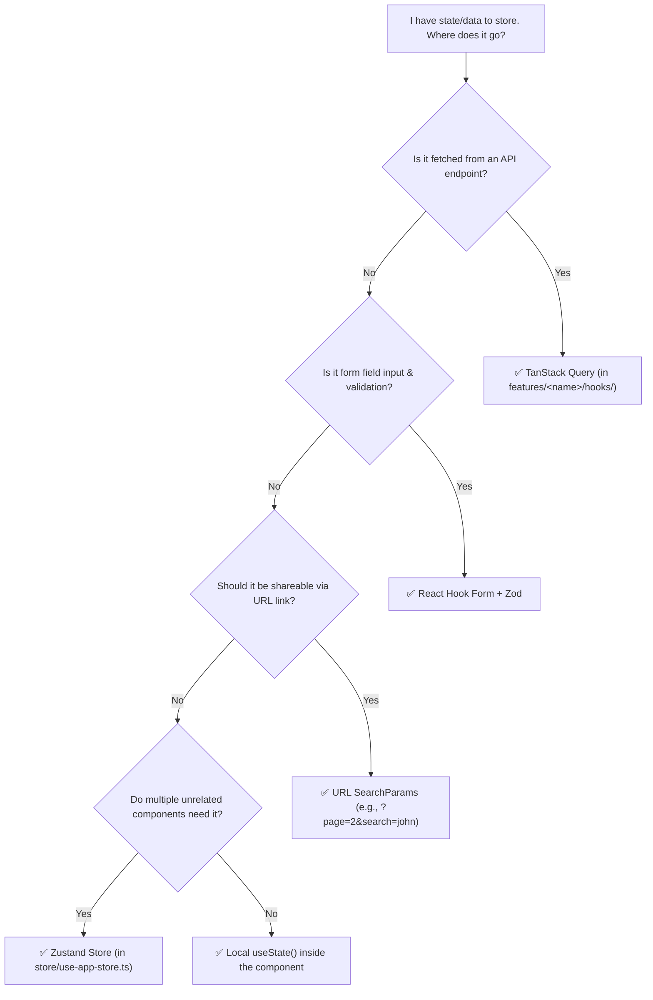

# 🏛️ Architecture & Project Structure Guide

Welcome to the **Frontend Starter Template** architecture guide! This document is designed to give you an immediate, crystal-clear understanding of where everything lives, how data flows through the application, and how to build new features with confidence.

---

## ⚡ Quick Navigation: "Where Do I Put...?"

| What do you want to do? | Where to go | Primary File(s) |
|---|---|---|
| **Add a new page/route** | `app/[locale]/<route>/` | `app/[locale]/<route>/page.tsx` |
| **Customize theme colors & fonts** | `app/` | `app/globals.css` & `tailwind.config.ts` |
| **Modify header, sidebar, or footer** | `components/layout/` | `navbar.tsx`, `sidebar.tsx`, `footer.tsx` |
| **Add or customize UI buttons, dialogs, inputs** | `components/ui/` | `button.tsx`, `dialog.tsx`, `input.tsx`, etc. |
| **Add new Arabic or English words** | `messages/` | `en.json` & `ar.json` |
| **Add a new API endpoint call** | `services/` | `services/<feature>-service.ts` |
| **Fetch/cache API data in components** | `features/<name>/hooks/` | Custom hooks wrapping TanStack Query |
| **Save global UI state (sidebar open, filters)** | `store/` | `store/use-app-store.ts` (Zustand) |
| **Change base API URL or auth storage key** | `constants/` & `.env` | `constants/index.ts` & `.env.local` |

---

## 🗺️ High-Level Architecture Map

The application follows a **layered, feature-driven architecture** where each responsibility is strictly isolated:



---

## 📂 Visual Directory Tree

```
basic/
│
├── 📁 app/                           # 🌐 Next.js App Router (Pages, Layouts & Boundaries)
│   ├── 📁 [locale]/                  # Dynamic locale segment (/en and /ar)
│   │   ├── 📁 components-showcase/   # UI component design system preview (/showcase)
│   │   │   └── page.tsx
│   │   ├── 📁 dashboard/             # Executive demo dashboard (/dashboard)
│   │   │   └── page.tsx
│   │   ├── error.tsx                 # Catches runtime page crashes with retry button
│   │   ├── layout.tsx                # Sets <html> lang, dir (RTL/LTR), fonts & providers
│   │   ├── loading.tsx               # Automatic skeleton loading placeholder
│   │   ├── not-found.tsx             # Localized 404 page
│   │   └── page.tsx                  # Landing / Home page
│   ├── globals.css                   # Tailwind styles, CSS variables & typography
│   ├── global-error.tsx              # Root fallback crash boundary
│   └── not-found.tsx                 # Root 404 fallback page
│
├── 📁 components/                    # 🎨 Shared UI Components
│   ├── 📁 layout/                    # Layout structure
│   │   ├── footer.tsx                # Application footer
│   │   ├── language-switcher.tsx     # 1-click toggle for English ↔ Arabic
│   │   ├── mobile-nav.tsx            # Slide-out drawer for mobile screens (<768px)
│   │   ├── navbar.tsx                # Sticky top header navigation
│   │   ├── page-container.tsx        # Standard content width wrapper
│   │   ├── page-header.tsx           # Page title + breadcrumbs + action buttons
│   │   ├── sidebar.tsx               # Collapsible dashboard sidebar
│   │   └── theme-toggle.tsx          # 1-click toggle for Light ↔ Dark mode
│   ├── 📁 providers/                 # Client React Context Providers
│   │   ├── app-providers.tsx         # Composite provider (Themes + Query + Toaster)
│   │   ├── query-provider.tsx        # TanStack QueryClient provider
│   │   └── theme-provider.tsx        # next-themes theme provider
│   └── 📁 ui/                        # 19 accessible shadcn/ui primitives
│       ├── button.tsx, input.tsx, select.tsx, checkbox.tsx, radio-group.tsx
│       ├── dialog.tsx, dropdown-menu.tsx, table.tsx, card.tsx, tabs.tsx
│       ├── tooltip.tsx, badge.tsx, breadcrumb.tsx, pagination.tsx, skeleton.tsx
│       ├── avatar.tsx, separator.tsx, label.tsx
│       └── empty-state.tsx, error-state.tsx
│
├── 📁 features/                      # 🧩 Business Domain Feature Modules
│   └── 📁 dashboard/                 # Dashboard feature module
│       ├── 📁 components/            # Analytics chart, data table, stats, form dialog
│       ├── 📁 hooks/                 # TanStack Query hooks & mutations
│       └── types.ts                  # Feature-specific types
│
├── 📁 services/                      # 📡 Pure API Service Functions
│   └── user-service.ts               # Type-safe API consumer methods
│
├── 📁 lib/                           # 🛠️ Shared Libraries & Utility Clients
│   ├── 📁 api/
│   │   └── axios-client.ts           # Centralized Axios with Bearer token & error interceptors
│   ├── query-client.ts               # TanStack Query singleton factory
│   └── utils.ts                      # cn() Tailwind class merger & currency formatters
│
├── 📁 store/                         # 💾 Global Client State
│   └── use-app-store.ts              # Zustand store (persisted sidebar, table filters)
│
├── 📁 hooks/                         # 🪝 Reusable Global React Hooks
│   ├── use-debounce.ts               # Debounces fast-changing values (search box)
│   ├── use-direction.ts              # Detects current RTL/LTR direction & active locale
│   ├── use-mobile.ts                 # Responsive screen size detector (<768px)
│   └── use-mounted.ts                # Client mounting guard to prevent hydration mismatch
│
├── 📁 i18n/                          # 🌍 Internationalization Configuration
│   ├── request.ts                    # Loads messages dynamically per request
│   └── routing.ts                    # next-intl routing definition & navigation helpers
│
├── 📁 messages/                      # 📖 Translation Dictionaries
│   ├── ar.json                       # Natural Arabic translations
│   └── en.json                       # Professional English translations
│
├── 📁 types/                         # 📝 Global TypeScript Definitions
│   ├── api.ts                        # Standard ApiResponse, ApiError, PaginatedResponse
│   └── index.ts                      # Core entities: User, Role, Status, Theme, etc.
│
├── 📁 constants/                     # 📌 Immutable Application Constants
│   └── index.ts                      # Navigation items, locale info, app config
│
├── middleware.ts                     # Next.js i18n locale routing middleware
├── next.config.mjs                   # Next.js config with in-memory dev cache & next-intl
├── tailwind.config.ts                # Tailwind design system configuration
├── tsconfig.json                     # Strict TypeScript configuration
└── components.json                   # shadcn/ui configuration
```

---

## 🔍 Layer Deep Dive: Purpose & Rules

---

### Layer 1: `app/` (Routing & Layouts)

> **Purpose**: Next.js App Router root. Handles URL routing, layout inheritance, and error/loading boundaries.

#### Key Files
- **`app/[locale]/layout.tsx`**: The master wrapper. Sets `lang="en" dir="ltr"` or `lang="ar" dir="rtl"`, imports fonts, and injects `AppProviders`.
- **`app/[locale]/page.tsx`**: Public landing page showcasing template architecture.
- **`app/[locale]/dashboard/page.tsx`**: The main dashboard demo screen.
- **`app/[locale]/components-showcase/page.tsx`**: Interactive catalog of all 19 UI components.
- **`app/[locale]/loading.tsx`**: Automatic loading skeleton displayed during page transitions.
- **`app/[locale]/error.tsx`**: Catches unhandled runtime errors and provides a "Try Again" recovery button.

> [!TIP]
> **Server vs. Client Rule**: Keep pages (`page.tsx`) as **Server Components** by default. Only add `"use client"` to interactive leaves that require event listeners (`onClick`, `onChange`), browser APIs, or React hooks.

---

### Layer 2: `components/` (Shared UI & Layouts)

> **Purpose**: Reusable visual building blocks. These components contain **zero domain business logic** and can be used on any page.

#### Subfolders
1. **`components/layout/`**: Structural chrome components:
   - `navbar.tsx`: Header navigation with mobile drawer trigger, brand logo, and controls.
   - `sidebar.tsx`: Collapsible side navigation with tooltip labels for collapsed mode.
   - `page-container.tsx`: Responsive horizontal margins (`max-w-7xl`, `max-w-4xl`, `max-w-full`).
   - `page-header.tsx`: Standardized top bar for titles, descriptions, and action buttons.
   - `theme-toggle.tsx`: 1-click animated toggle between Light and Dark mode.
   - `language-switcher.tsx`: 1-click toggle between English and Arabic.
2. **`components/ui/`**: Pure design system primitives (shadcn/ui):
   - Buttons, Badges, Inputs, Selects, Checkboxes, Dialogs, Tables, Tabs, Tooltips, Empty States, and Error States.
3. **`components/providers/`**: Composite client providers (`AppProviders`) wrapping NextThemes, TanStack Query, and Sonner Toaster.

> [!IMPORTANT]
> **Logical Styling Rule**: Never use physical classes like `pl-4` or `mr-2` in components. Always use logical properties: `ps-4` (padding-start), `pe-4` (padding-end), `ms-auto`, `me-2`, and `text-start`. This ensures automatic RTL alignment in Arabic.

---

### Layer 3: `features/` (Business Modules)

> **Purpose**: Houses domain-specific code. When building a real feature (e.g., `invoices`, `analytics`, `users`), create a dedicated folder inside `features/`.

#### Anatomy of a Feature Folder (e.g., `features/dashboard/`):
```
features/dashboard/
├── components/          # UI specific to this feature only
│   ├── analytics-chart.tsx
│   ├── data-table.tsx
│   ├── overview-stats.tsx
│   └── user-form-dialog.tsx
├── hooks/               # TanStack Query query & mutation hooks
│   └── use-dashboard-data.ts
└── types.ts             # TypeScript interfaces private to this feature
```

> [!NOTE]
> **Why this matters**: Instead of hunting across 5 different folders for files relating to the dashboard, everything belonging to that feature lives together. Deleting or refactoring a feature is clean and isolated.

---

### Layer 4: `services/` & `lib/api/` (Network & HTTP)

> **Purpose**: Cleanly abstracts API communication. UI components never call raw `fetch()` or `axios()`.

#### The Flow:
1. **`lib/api/axios-client.ts`**:
   - Centralized Axios instance with base URL from `NEXT_PUBLIC_API_URL`.
   - **Request Interceptor**: Automatically attaches `Authorization: Bearer <token>` from `localStorage`.
   - **Response Interceptor**: Translates raw network/HTTP errors into clean `ApiError` objects.
   - **Auto-Logout**: Automatically evicts tokens on 401 Unauthorized status.
2. **`services/<feature>-service.ts`**:
   - Plain async functions (`getUsers()`, `createUser()`) returning typed data via `apiClient`.
3. **`features/<feature>/hooks/`**:
   - TanStack Query hooks calling the service functions with automatic caching, background revalidation, and toast notifications.

---

### Layer 5: `store/` (Global Client State)

> **Purpose**: Manages lightweight client-side UI state that multiple unrelated components need to share.

- **`store/use-app-store.ts`**:
  Powered by **Zustand** with persistent storage support:
  - `sidebarCollapsed`: Toggle state of the dashboard sidebar (saved in `localStorage`).
  - `mobileMenuOpen`: Drawer state on mobile viewports.
  - `selectedRoleFilter`, `selectedStatusFilter`, `tableSearchQuery`: Shared filter states.

---

### Layer 6: `messages/` (Internationalization Dictionaries)

> **Purpose**: Translation dictionaries powering bidirectional bilingual support via `next-intl`.

- **`messages/en.json`**: English strings organized by logical namespace (`common`, `nav`, `dashboard`, `userForm`, etc.).
- **`messages/ar.json`**: Matching natural Arabic phrasing with identical JSON keys.

---

## 🔄 Sequence: How a User Action Flows Through the Code



---

## 🧭 Decision Matrix: Where Should My State Live?



---

## 📐 RTL vs. LTR Cheat Sheet

Always use **logical CSS properties** to ensure complete bidirectional compatibility:

| Instead of Physical (❌ Avoid) | Use Logical (✅ Recommended) | Result in LTR (English) | Result in RTL (Arabic) |
|---|---|---|---|
| `pl-4` | `ps-4` | Padding Left | Padding Right |
| `pr-4` | `pe-4` | Padding Right | Padding Left |
| `ml-auto` | `ms-auto` | Margin Left Auto | Margin Right Auto |
| `mr-2` | `me-2` | Margin Right | Margin Left |
| `left-0` | `start-0` | Position Left | Position Right |
| `right-0` | `end-0` | Position Right | Position Left |
| `text-left` | `text-start` | Left aligned | Right aligned |
| `text-right` | `text-end` | Right aligned | Left aligned |
| `border-l` | `border-s` | Left border | Right border |
| `ChevronRight` | `<ChevronRight className="rtl:rotate-180" />` | Points Right (→) | Points Left (←) |

---

## 🧑‍💻 Step-by-Step Developer Recipes

### Recipe 1: How to Add a New Page (`/billing`)

1. **Create the file**: `app/[locale]/billing/page.tsx`
2. **Add page skeleton**:
   ```tsx
   import { setRequestLocale } from "next-intl/server";
   import { PageContainer } from "@/components/layout/page-container";
   import { PageHeader } from "@/components/layout/page-header";

   export default async function BillingPage({
     params,
   }: {
     params: Promise<{ locale: string }>;
   }) {
     const { locale } = await params;
     setRequestLocale(locale);

     return (
       <PageContainer>
         <PageHeader title="Billing & Invoices" />
         <div className="rounded-lg border bg-card p-6">
           <p className="text-muted-foreground">Manage your payment methods and plans.</p>
         </div>
       </PageContainer>
     );
   }
   ```
3. **Add navigation link**: In `constants/index.ts`, add to `NAV_ITEMS`:
   ```ts
   { key: "billing", href: "/billing", icon: "CreditCard" }
   ```

---

### Recipe 2: How to Add a New API Call

1. **Define service** in `services/billing-service.ts`:
   ```ts
   import apiClient from "@/lib/api/axios-client";
   import type { ApiResponse } from "@/types/api";

   export interface Invoice {
     id: string;
     amount: number;
     status: string;
   }

   export const billingService = {
     async getInvoices(): Promise<Invoice[]> {
       const res = await apiClient.get<ApiResponse<Invoice[]>>("/invoices");
       return res.data.data;
     },
   };
   ```

2. **Wrap in a TanStack Query Hook** in `features/billing/hooks/use-invoices.ts`:
   ```ts
   "use client";

   import { useQuery } from "@tanstack/react-query";
   import { billingService } from "@/services/billing-service";

   export function useInvoicesQuery() {
     return useQuery({
       queryKey: ["invoices"],
       queryFn: () => billingService.getInvoices(),
     });
   }
   ```

---

### Recipe 3: How to Add a New Bilingual Translation

1. In `messages/en.json`:
   ```json
   "billing": {
     "title": "Billing & Invoices",
     "upgrade": "Upgrade Plan"
   }
   ```
2. In `messages/ar.json`:
   ```json
   "billing": {
     "title": "الفواتير والاشتراكات",
     "upgrade": "ترقية الخطة"
   }
   ```
3. Use in any component:
   ```tsx
   import { useTranslations } from "next-intl";

   export function BillingHeader() {
     const t = useTranslations("billing");
     return <h1>{t("title")}</h1>;
   }
   ```

---

## 🎯 Summary Checklist for Production Readiness

- [x] **Strict TypeScript**: Strict mode enabled with zero `any` types.
- [x] **Zero ESLint Warnings**: Verified clean code standards.
- [x] **Zero Build Errors**: Tested with `next build`.
- [x] **Flawless RTL Support**: Automatic layout mirroring for Arabic.
- [x] **1-Click Toggles**: Fast theme and language switching.
- [x] **OneDrive Safe**: Memory-based dev caching configured in `next.config.mjs`.
